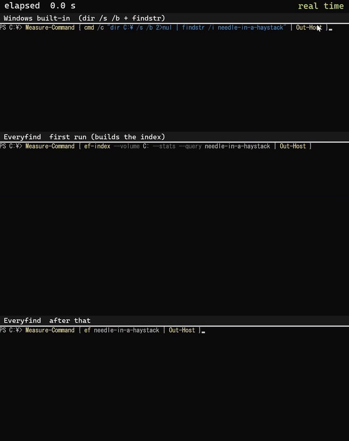

# Everyfind

> ぼくのかんがえた、さいきょうの検索ツール

[English](README.md)

Windowsのファイル名をターミナルで即座に検索します。NTFSボリュームの索引をメモリ上に持ち続けるので、数百万件のファイル名をミリ秒で引けます。ディスク使用量も同じ索引からすぐに集計します。

[](https://github.com/kyo5uke/everyfind/actions/workflows/ci.yml) [](#ライセンス)


```text
ef notes            # 名前に"notes"を含む全ファイル・フォルダ（約14 ms）
ef                  # 対話画面: 打ちながら絞り込み、Enterでファイルを開く
ef du C:\Users      # C:\Users以下で容量を食っているもの（索引から集計）
```

仕組みは[Everything](https://www.voidtools.com/)（voidtools）と同じです。NTFSのマスターファイルテーブル（MFT）を直接読んで全ファイル名の索引を作り、あとはUSN変更ジャーナルを追って最新に保ちます。検索のためにディレクトリをたどることはありません。さらに任意で、[エクスプローラーの検索をこの索引に差し替える](#エクスプローラー統合)こともできます。

## インストール

動作条件は、Windows 10/11、NTFSボリューム、x86_64です。

[Releases](https://github.com/kyo5uke/everyfind/releases)からzipをダウンロードして展開し、実行します。

```text
.\install.ps1
```

Windowsは、ダウンロードしたスクリプトを既定でブロックします。「デジタル署名されていません」「スクリプトの実行が無効」と拒否されたときは、`powershell -ExecutionPolicy Bypass -File .\install.ps1`として実行してください。一度`Unblock-File .\install.ps1`を実行してから、普通に起動しても構いません。

バイナリを`%ProgramFiles%\Everyfind`に置いて`PATH`を通し、索引サービスを登録・起動して、最初の索引ができるまで待ちます。目安は、速いNVMeのデスクトップで約10秒（470万ファイルで実測）、キャッシュが空のノートでは数分です。索引を作るときはMFTを丸ごと、数ギガバイト読むので、そのデータがディスクキャッシュに載っていないときに遅くなります。2回目以降の起動はスナップショットから数秒で復帰します。

管理者権限の要求はこの一度だけです。サービスの登録と、ボリュームを直接読むことの両方に必要です。理由は[下の節](#索引にはなぜ管理者権限が要るのか)で説明しています。

### 同梱物

| | |
|---|---|
| `ef.exe` | 実際に使うコマンド。検索、`ef du`、TUI、`ef explorer engine` / `ef service`のサブコマンドが入っています |
| `efd.exe` | 索引デーモン。サービスが起動するので、自分で呼ぶことはありません |
| `ef_search_engine.dll` | エクスプローラー統合。`ef explorer engine install`を実行したあとにだけ、エクスプローラーが読み込みます |
| `ef-index.exe` | 索引エンジンを単体で走らせる計測用のコマンド。ゼロから索引を作って時間を測る、スナップショットに保存する、USNジャーナルを追う、といったことを1プロセスで行います。常用には不要で、このREADMEのベンチマークを再現するためのものです |

**エクスプローラーの検索だけが速くなればいい場合**は、`.\install.ps1 -WithExplorer`の一発で索引・サービス・検索ボックスまで全部済みます。`ef`を一度も打つ必要はありません。元に戻すときは`ef explorer engine uninstall`を実行します。

ソースから入れる場合は、Rust stableとMSVCツールチェーンで次を実行します。

```text
cargo install --git https://github.com/kyo5uke/everyfind
```

全部消すには`uninstall.ps1`を実行します。展開したフォルダにあるものでも、インストーラがバイナリの隣に置いたコピー（`& "$env:ProgramFiles\Everyfind\uninstall.ps1"`）でも構いません。サービス、そのデータ、`PATH`の項目、レジストリキー、バイナリを取り除きます。

### SmartScreenとDefenderについて

配布バイナリには署名がありません。初回起動時に「WindowsによってPCが保護されました」が出たら、「詳細情報」を押してから「実行」を押してください。また、Windows Defenderが署名なしの新しいRustバイナリをMLヒューリスティック（`Bearfoos.B!ml`など）で誤検知することがあります。バイナリにはバージョン情報を埋め込んで検知されにくくしてあり、リリースごとにMicrosoftへ誤検知報告を出しています。それでも出た場合は、保護履歴からファイルを復元してインストールフォルダを除外に追加するか、ソースからビルドしてください。

### サービスを入れない場合

ボリュームを直接読むには管理者権限が要ります。既定では、LocalSystemで動くサービスにその権限を持たせますが、常駐させたくない場合は自分で持つこともできます。

```text
.\install.ps1 -NoService
```

この場合、サービス登録も常駐もありません。バイナリはユーザープロファイル配下に置かれ、ユーザー環境変数の`PATH`だけが通り、管理者権限も要求されません。索引を動かしたいときだけ、管理者ターミナルからデーモンを自分で起動します。

```text
efd --foreground --volume C:
```

これを起動している間は、普通のターミナルから`ef`をサービス構成と同じように使えます。閉じると、Everyfindのプロセスは残りません。

### 手で入れる場合

インストーラが行う処理は、実質的に次の2つのコマンドと同じです。管理者ターミナルで実行してください。

```text
ef service install    # 索引サービスを登録（既定は --volume C:）
ef service start
```

手で入れた場合のアンインストールは`ef service uninstall`です。

## 使い方

```text
ef <検索語>           # 一発検索: 一致した絶対パスを標準出力へ
ef                    # 対話画面（ef -i <検索語>で初期値を入れて起動）
ef content <正規表現> # ファイルの中身を検索（今いるフォルダ以下が対象）
ef du [パス]          # パス以下で大きいフォルダ・ファイル（既定はボリュームのルート）
ef status             # デーモンの状態: 件数、ジャーナル遅延、メモリ、稼働時間
```

### パイプで使う

出力をパイプや変数で受けるとき、`ef <検索語>`はパスだけを1行1件で出します。ほかのコマンドへそのまま渡せます。

```text
ef ext:iso | Select-Object -First 3
ef ext:iso | ForEach-Object { (Get-Item -LiteralPath $_).Length }
```

`-n`を付けなければ、パイプにはデーモンが返す全件が流れます。上限は1回の検索につき10万件です。端末では、件数の見出しに続けて先頭20件を表示します。どちらも`-n`で変えられます。終了コードは`grep`と同じで、一致があれば0、なければ1、検索できなかったときは2です。

Windows PowerShell 5.1は、プログラムの出力をUTF-8ではなくコンソールのコードページで読みます。そのため、日本語などを含むパスは、パイプや変数で受けると文字化けします。先に次を実行してください。毎回必要なら、プロファイルに書いてください。

```text
[Console]::OutputEncoding = [Text.Encoding]::UTF8
```

端末にそのまま表示される出力には影響しません。

### 対話画面

文字を打つたびに検索します。`↑` `↓` `PgUp` `PgDn`で選択を移動し、`Enter`で選んだファイルやフォルダを関連付けられたプログラムで開きます。`Ctrl+O`でも開けます。`Ctrl+Enter`か`Ctrl+J`を押すと、そのパスを標準出力に出して終了します。`Ctrl+Y`でパスをコピー、`Ctrl+E`でエクスプローラーに表示、`Esc`か`Ctrl+C`で終了します。検索語の編集では、`Ctrl+U`で行全体を、`Ctrl+W`でカーソルの直前の単語を消します。

画面は標準エラーに描き、標準出力には選んだパスしか流さないので、次のようにシェルと組み合わせられます。

```text
vim $(ef)             # 対話画面でファイルを選んでvimで開く
$dir = ef; cd $dir    # PowerShell: 選んだディレクトリへ移動
```

このように出力を受け取っているときは、シェルがパスを待っているので、`Enter`だけでもパスを出力します。ファイルを開くときは`Ctrl+O`を使います。どちらの状態かは、何も入力していない画面のキー一覧に表示されます。

### ディスク使用量

`ef du`は「何がディスクを食っているか」に、検索と同じ常駐索引から答えます。ボリューム全体の集計にかかる時間は中央値96 msで、そのあいだディスクは読みません。

```text
ef du                 # ボリュームで容量を食っているもの
ef du C:\Users -d 2   # 2階層分
ef du .               # いまいるフォルダ（相対パスも使えます）
ef du -n 50 --bytes   # 行数を増やす、生のバイト数で
```

サイズはディスク上の割り当てバイト数です。ハードリンクは1回だけ数え、スパース／圧縮ファイルは実際の割り当て量、ジャンクションやリパースポイントは辿らず、代替データストリームは除外します。

### 中身検索

`ef content <正規表現>`はファイルの中身を検索します。組み込みの[grix](https://crates.io/crates/grix)エンジンが答えます。grixは、trigram索引とripgrep互換の確認スキャンを組み合わせたエンジンです。あるフォルダ以下で初めて検索するときは、その場でスキャンして答えながら裏で索引を作り、2回目からは索引を使って検索します。Linuxカーネルの全ソース9.3万ファイルでは、索引を使った検索が約0.2秒です。処理はクライアントの中だけで行い、デーモンと名前索引は使いません。

```text
ef content kmalloc_array        # この文字列を含む全行
ef content "TODO.*deprecat"     # ripgrep互換の正規表現
```

## クエリ言語

Everythingのクエリ言語です。空白はAND、`|`はOR、`!`は否定、`<…>`はグループ化。結合の強さはNOT → AND → ORの順です。

```text
ef report 2024                    # 両方の語を含む
ef 'cargo.toml | package.json'    # どちらか
ef 'readme <ext:md | ext:txt>'    # グループ化で優先順位を上書き
ef 'log !cache !ext:tmp;bak'      # 否定
ef *.dll                          # ワイルドカードは名前全体に一致（* と ?）
ef src\util                       # 区切り文字を含む語はパスに一致
ef '\"annual report\"'            # フレーズ: 二重引用符で空白ごと1語に
```

上の例はPowerShellでの書き方です。クエリは`ef`に届く前にシェルを通ります。`|` `<` `>` `;` `!`はどれもシェルにとって意味のある記号なので、これらを含むクエリは全体を引用符で囲みます。PowerShellとbashでは単引用符、cmd.exeでは二重引用符を使い、cmd.exeなら`ef "cargo.toml | package.json"`のように書きます。bashでは`*.dll`と`src\util`も囲む必要があります。

フレーズは、クエリ自身が二重引用符を含みます。これも`ef`まで届かせる必要があり、書き方はシェルごとに違います。

```text
ef '\"annual report\"'     # Windows PowerShell 5.1
ef '"annual report"'       # PowerShell 7.3以降、bash
ef "\"annual report\""     # cmd.exe
```

こうしないと、シェルが引用符を取ってしまい、`ef "annual report"`は`annual`と`report`の2語になります。対話画面では間にシェルが入らないので、クエリはそのまま打てます。

先頭の語がサブコマンド名（`status` `du` `config` `content`とその短縮形`c`、`service` `shell` `explorer` `help`）と同じだと、そのサブコマンドが動きます。その語を検索したいときは、前に`--`を置いて`ef -- status`と書きます。オプションは`--`より前に置き、`ef -n 50 -- status`のように書きます。

修飾子は直後の語の解釈を変えます。いくつか重ねて使えます。

| 修飾子 | 何をするか |
|---|---|
| `case:` `nocase:` | 大文字小文字を区別する／しない |
| `path:` `nopath:` | フルパスに一致／名前だけに一致 |
| `ww:` `wholeword:` | 単語全体であること |
| `wfn:` `wholefilename:` | 名前全体が一致すること |
| `startwith:` `endwith:` | 先頭／末尾に固定 |
| `regex:` `pathregex:` | 正規表現 |
| `wildcards:` `nowildcards:` | `*`と`?`を有効／無効に |

関数はそれ自体が条件になります。

| 関数 | 何に一致するか |
|---|---|
| `ext:rs;toml` | 拡張子がいずれか |
| `file:` `folder:` | 種類を限定 |
| `size:>1mb` `size:1mb..2mb` `size:large` | 割り当てサイズ |
| `len:<8` `parents:2` `root:` | 名前の長さ、階層の深さ、ドライブ直下 |
| `empty:` `dupe:` | 空フォルダ／0バイトファイル、同名が複数あるもの |
| `child:cargo.toml` | その子を持つディレクトリ |
| `childcount:0` `childfilecount:>10` `childfoldercount:` | |
| `attrib:d` `attrib:l` | ディレクトリ、リパースポイント |
| `audio: video: pic: doc: exe: zip: font: code:` | 拡張子のグループ |
| `count:50` | 結果数の上限 |

数値は`123 >123 >=123 <123 <=123 =123`と`100..200`が使えます。サイズはさらに`kb mb gb tb`と`empty tiny small medium large huge gigantic`を受け付けます。

次のものは使えないか、制限があります。

- 日付での絞り込み（`dm:` `dc:` `da:`）はありません。索引の元にしているMFTの列挙はタイムスタンプを返さず、対応するにはMFTのレコードを直接解析する必要があります。
- `size:`は、`ef du`と同じクラスタ単位の割り当てサイズです。1バイトのファイルも1クラスタとして数えます。
- `attrib:`で指定できる属性は、ディレクトリとリパースポイントの2つだけです。
- 名前の索引にファイルの中身は入っていません。中身の検索は、別エンジンの`ef content <正規表現>`で行います。

結果は順位付けされます。名前が完全一致するものが先、次に名前の先頭一致、最後に部分一致の順です。同順位ならパスが短い方が上です。既定では大文字小文字を区別しません。

常用の除外は`%APPDATA%\everyfind\excludes.txt`に置きます。1行に1つずつパスの一部を書き、`#`でコメントを書けます。すべての検索に`!path:`として適用されます。`ef config`で読み込まれている内容を確認でき、`--no-excludes`で1回だけ無効にできます。

## エクスプローラー統合

エクスプローラーの検索ボックスにも、Windows Searchの代わりにEveryfindの索引で答えさせられます。


同じ検索ボックス・同じクエリ・同じボリュームでの、Windows Searchのままの検索と、Everyfindエンジンに差し替えた検索です。2本は別々にキャッシュを空にしてから録画し、検索が始まる瞬間で頭を揃えています。x32は早送りの印です。

```text
ef explorer engine install
```

このコマンドを実行したときだけ有効になります。実行すると、次の表の3つを書き込みます。どれもユーザー単位の変更で、`HKEY_LOCAL_MACHINE`やシステムのファイル、ほかのプロセスには手を加えません。

| 何を | どこに |
| --- | --- |
| COMクラス登録3つ。配置したDLLを指し、それぞれ元のサーバのパスを`RealDll`値に控えて、そこへ全ての呼び出しを転送します | `HKCU\Software\Classes\CLSID\{…}\InprocServer32` |
| DLL本体。エクスプローラーが開いたまま使っているDLLを差し替えずに済むよう、内容のハッシュを含む名前で配置します | `%LOCALAPPDATA%\everyfind\` |
| デーモンが担当しているボリュームのクロールスコープ規則1行。Windows Search自身の`ISearchCrawlScopeManager` API経由で追加します。エクスプローラーがどのエンジンに問い合わせるかを決めるだけで、索引は作りません | Windows Searchのカタログ |

この規則は、Everyfindが実際に担当しているボリュームにだけ追加します。Everyfindが答えられないドライブは、これまでどおりWindows Searchが検索し続けます。

元に戻すときは、次を実行します。

```text
ef explorer engine uninstall
```

このコマンドで、インストール時に書き込んだものをすべて元に戻します。クロールスコープ規則は、この機能が追加したものである場合にだけ取り除きます。次の検索から、エクスプローラーはWindows Searchで検索します。

## ベンチマーク

まず、追加の道具を使わずに比べます。索引なしでC:をたどる`dir /s /b | findstr`、MFTから索引をゼロから作って1回だけ検索する`ef-index`、常駐デーモンに問い合わせる`ef`の3つです。



3本は別々に録画し、それぞれ実行前にキャッシュを空にし、Enterの瞬間で頭を揃えています。画面内の`Measure-Command`の出力が、その回の実測値です。×8 / ×64は早送りの印です。

実機のC:（MFTエントリ約500万件、うち生存480万件）でファイル名を検索し、Everyfindの常駐索引と[fd](https://github.com/sharkdp/fd)を比べた結果です。fdは優秀な並列のファイル走査ツールですが、問い合わせのたびにディレクトリツリーを走査し直します。

| C:全体への問い合わせ（約500万件） | Everyfind（起動済みのデーモン） | fd 10.5.0（毎回走査） |
|---|---:|---:|
| `kernel32`を名前で検索 | **中央値13.5 ms**（起動から結果まで） | 2回目以降3.0〜4.0秒（初回18.2秒） |
| ボリューム全体のディスク使用量（`ef du C:\`） | **中央値96 ms** | 機能なし |

### 測定方法

同一マシン（Ryzen 9 9950X3Dのデスクトップ、NVMe、Windows 11 Pro、管理者ターミナル、稼働中のボリューム）で測りました。Everyfindは`ef kernel32`の起動から結果が出るまで（プロセス起動 + 名前付きパイプの往復 + 並列索引走査）、`examples/bench_ef.rs`の`CreateProcess`直起動ハーネスでn=100: 最小12.3 / 中央値13.5 / p95 16.1 ms。シェル経由で起動すると、シェル自身が約55 ms足します。パイプ往復だけなら中央値3.9 ms（n=200）。`ef du C:\`は起動から結果まで5回測って92〜102 ms。fdは`fd -uu kernel32 C:/`を、ウォームアップ1回（18.2秒）のあと3回実行して、3.96 / 3.13 / 3.04秒でした。`-uu`は隠しファイルを含め、ignoreファイルを無視する指定で、MFT索引が見ている範囲と揃えています。初回は、ファイルシステムキャッシュが空だった分だけ時間がかかっています。ヒット数は両者で違います（22対154）。`kernel32*`の大半がWinSxSのハードリンクで、Everyfind v0.1は1ファイルにつき1つの名前しか索引しないためです。詳しくは下の「既知の制限」を見てください。

同じベンチマークをCore Ultra 7 258Vのノートで測った過去の値は、Everyfind約15 ms・fd平均104.6秒（67.9〜128.4秒）でした。ハードが約11倍速くなって、走査は「分」から「秒」になりました。索引の方は、どちらのマシンでもメモリから答えるので、ほとんど変わっていません。

## 仕組み

- 初回索引は、NTFSが全ファイルの台帳として持つMFTを`FSCTL_ENUM_USN_DATA`で直接列挙して作ります。ディレクトリをたどらないので、470万ファイルでも速いデスクトップなら約10秒で終わります。
- 以後はNTFSの変更履歴であるUSNジャーナルを約1秒ごとにポーリングし、作成・削除・改名・移動を索引に反映します。変更がないあいだは、ほとんど負荷がかかりません。ジャーナルが一周したり壊れたりした場合は、それを検知して再列挙します。
- 索引は1エントリにつきファイル名と親へのリンクだけを持ち、フルパスは必要になった時点で組み立てます。100万ファイルあたり常駐メモリ約90〜110 MB。検索は大文字小文字を区別しない並列の部分文字列走査です。
- `ef du`のサイズは`$MFT`そのものから来ます。索引を作るときに各ファイルのデータランから割り当てクラスタ数を読み、ジャーナルを追うことで最新に保ちます。そのため、ボリューム全体の集計はメモリの中だけで済みます。
- ボリュームハンドル越しには読み取りのFSCTLしか発行せず、索引対象のボリュームには書き込みません。スナップショットとログは`C:\ProgramData\everyfind`に置きます。

### 索引にはなぜ管理者権限が要るのか

生のボリュームハンドル（`\\.\C:`）越しのMFTとUSNジャーナルの読み取りは特権操作で、Windowsは昇格したトークンを要求します。Everythingの索引も同じです。この権限はデーモンにしか要らないので、デーモンをサービス（LocalSystem）として入れ、特権をそこに閉じ込めます。`ef`クライアントは名前付きパイプでデーモンとやり取りするので、普通の非昇格ターミナルで問題なく動きます。

## Everythingとの違い

[Everything](https://www.voidtools.com/)は素晴らしいソフトです。GUIが欲しいならそちらを使ってください。Everyfindは別の使い方を狙っています。

- ターミナルで使うことを前提にしています。対話画面と、パスだけを標準出力に出す一発検索があり、`vim $(ef)`のようにシェルと組み合わせられます。SSH越しでも動きます。EverythingのCLI（`es.exe`）はEverythingのGUIアプリかそのサービスが動いている必要がありますが、Everyfindは単体で完結します。
- オープンソースです。ライセンスはMITまたはApache-2.0で、素のRustで書かれ、UIフレームワークは同梱していません。
- `du`が最初から入っています。ディスク使用量の集計を、検索と同じ、最新に保たれた索引から返します。

## 既知の制限（v0.1）

- WindowsとNTFSにしか対応していません。1つのデーモンが担当するボリュームは1つで、既定は`C:`です。索引にはファイル名だけが入り、ファイルの中身は入りません。
- ハードリンクされたファイルは、1つの名前でしか索引されません。`C:\Windows\System32`のファイルの多くはWinSxSへのハードリンクなので、たとえば`kernel32.dll path:system32`ではSystem32側の名前が見つかりません。v0.2で、すべてのリンク名を索引する予定です。
- エクスプローラーで検索したあと、検索ボックスに続けて文字を打つと「検索条件に一致する項目はありません。」と出ます。EnterかF5を押すと、正しい結果が出ます。文字を打ち足すと、エクスプローラーは検索し直さず、今出ている結果を土台に絞り込もうとします。この絞り込みはWindows Search自身のエンジンが出した結果にしか使えず、Everyfindの結果では失敗して、そこで検索をやめてしまいます。EnterやF5では一から検索し直すので、Everyfindがいつもどおり答えます。
- 電源プランによって、速さが大きく変わります。検索はメモリ帯域で速さが決まる並列走査なので、ノートPCで電源プランが「バランス」かつバッテリー駆動のときは、約4倍遅くなることがあります。いちばん速く応答させたいときは、AC電源につないで電源プランを「高パフォーマンス」にしてください。
- 1人で使うことを前提にしています。重い検索を同時にたくさん実行すると、CPUを奪い合います。検索は1つずつ実行することを想定しています。なお索引は全ユーザーのファイル名を保持し、デーモンのパイプは既定で対話ユーザーに開かれています。`ef service install --acl admins`で制限できます。
- 対話画面は、絵文字などのサロゲートペアの文字を入力できるように、コンソール入力を自前で読んでいます。ライブラリ側には、こうした文字を取りこぼす未修正のバグ（[crossterm #561](https://github.com/crossterm-rs/crossterm/issues/561)）があり、それを避けています。入力がおかしいときは、`EF_INPUT=crossterm`でライブラリ側の読み取りに戻せます。その場合も日本語などのBMPの文字は入力でき、サロゲートペアの文字だけが入力できなくなります。絵文字を含む名前のファイルは、どちらの場合も正しく索引・検索・表示されます。
- まれに、UTF-16のサロゲートが対になっていないファイル名があります。こうした名前は、対になっていない部分を`U+FFFD`に置き換えて索引します。

## ビルド

`rust-toolchain.toml`で、Rust stableの`stable-x86_64-pc-windows-msvc`に固定しています。

```text
cargo build --release
cargo test && cargo clippy --all-targets -- -D warnings && cargo fmt --check
```

デーモンやMFTの列挙のように実際のボリュームを触るものには、管理者ターミナルが必要です。`cargo test`単体では不要です。テストはプロセス内の偽ボリュームに対して走り、実機が要る少数のテストは既定で`#[ignore]`されています。

## ライセンス

以下のいずれかを選択できます。

- Apache License, Version 2.0（[LICENSE-APACHE](LICENSE-APACHE)）
- MIT license（[LICENSE-MIT](LICENSE-MIT)）

明示的に別段の定めをしない限り、Apache-2.0の定義における、あなたがこの成果物に含めることを意図して提出した貢献は、追加の条件なしに上記のデュアルライセンスとなります。