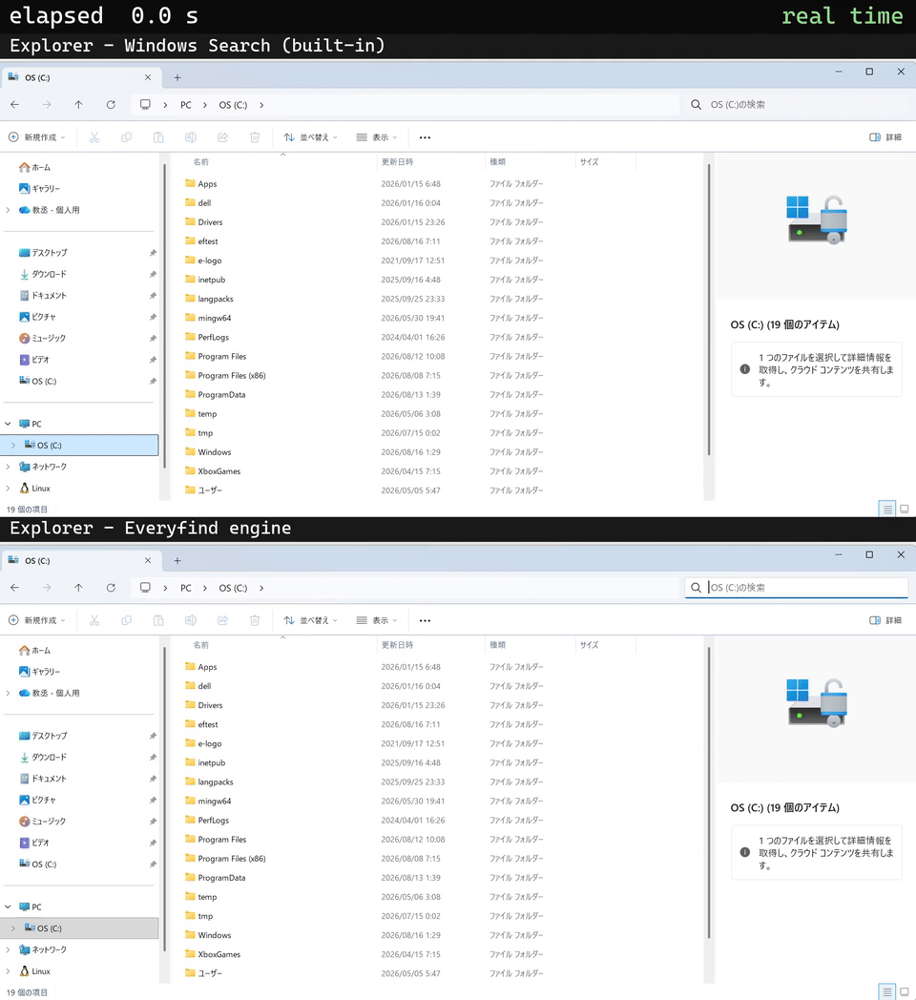

# Everyfind

[日本語](README.ja.md)

**Instant filename search for Windows, in your terminal.** Everyfind keeps an index of your NTFS volume in memory, so it can find any of millions of filenames in milliseconds. Disk usage comes from the same index, just as fast.

[](https://github.com/kyo5uke/everyfind/actions/workflows/ci.yml) [](#license)


```text
ef notes            # every file and folder whose name contains "notes" — about 14 ms
ef                  # interactive: type to narrow, Enter prints the path
ef du C:\Users      # what's eating space under C:\Users — straight from the index
```

It works the way [Everything](https://www.voidtools.com/) (voidtools) does: it reads the NTFS Master File Table directly to build an index of every filename in seconds, then tails the USN change journal to keep it current. Searching never walks a directory. Optionally, it can also [answer Explorer's own search box](#explorer-integration) from that index.

## Install

**Requirements:** Windows 10/11, an NTFS volume, x86_64

Download the zip from [Releases](https://github.com/kyo5uke/everyfind/releases), unzip it, and run:

```text
.\install.ps1
```

If PowerShell refuses with *"is not digitally signed"* or *"running scripts is
disabled"* — Windows blocks downloaded scripts by default — run it as
`powershell -ExecutionPolicy Bypass -File .\install.ps1` instead (or
`Unblock-File .\install.ps1` once, then run it normally).

It puts the binaries in `%ProgramFiles%\Everyfind`, adds the folder to `PATH`, registers and starts the indexing service, and waits for the first index. Expect roughly 10 seconds on a fast NVMe desktop (measured: 4.7M files) and up to a few minutes on a laptop with a cold disk cache: building the index reads the whole Master File Table, several gigabytes of it — which is exactly what a first install on a machine that has been doing something else looks like. Every start after that resumes from a snapshot in a couple of seconds.

That's the only time Administrator is asked for. Both registering the service and reading the raw volume need it ([why](#why-does-the-indexer-need-administrator)).

### What's in the package

| | |
|---|---|
| `ef.exe` | the command you use: search, `ef du`, the TUI, and the `ef explorer engine` / `ef service` subcommands |
| `efd.exe` | the indexing daemon. The service runs it; you never call it yourself |
| `ef_search_engine.dll` | the Explorer integration. Explorer loads it only after `ef explorer engine install` |
| `ef-index.exe` | the index engine on its own, for measurement: build an index from scratch and time it, save it to a snapshot, tail the USN journal — all in one process. Not needed for normal use; it is how the benchmarks in this README are reproduced |

**If all you want is a faster Explorer search**, `.\install.ps1 -WithExplorer` does the whole
thing in one command — index, service, and search box — and you need never type `ef` at all.
Undo any time with `ef explorer engine uninstall`.

To install from source, with Rust stable and the MSVC toolchain:

```text
cargo install --git https://github.com/kyo5uke/everyfind
```

To remove everything, run `.\uninstall.ps1`. It takes out the service, its data, the `PATH` entry, the registry keys, and the binaries.

### SmartScreen and Defender

The released binaries are unsigned. If "Windows protected your PC" appears on first run, click **More info → Run anyway**. Windows Defender may also flag a freshly built, unsigned Rust binary through an ML heuristic (`Bearfoos.B!ml` and friends), which is a false positive. The binaries carry version metadata to make that less likely, and every release is submitted to Microsoft's false-positive review. If it still happens, restore the file from Protection History and add an exclusion for the install folder, or build from source.

### Without a service

Reading the raw volume needs Administrator. By default the service (LocalSystem) is what holds that right, but if you'd rather have nothing resident, you can hold it yourself:

```text
.\install.ps1 -NoService
```

Nothing is registered and nothing stays running. The binaries go under your own profile, only your user `PATH` is touched, and Administrator is never asked for. Start the indexer yourself, from an Administrator terminal, whenever you want it:

```text
efd --foreground --volume C:
```

While that's running, `ef` works from any ordinary terminal exactly as it does with the service. Close it and nothing of Everyfind is running at all.

### By hand

That's effectively all the installer does. Run it in an Administrator terminal:

```text
ef service install    # register the indexing service (defaults to --volume C:)
ef service start
```

If you set it up by hand, uninstall with `ef service uninstall`.

## Usage

```text
ef <query>            # one-shot: print matching absolute paths to stdout
ef                    # interactive (ef -i <query> starts it seeded)
ef content <regex>    # search inside files, under the current directory's tree
ef du [path]          # the biggest folders and files under path (default: the volume root)
ef status             # daemon health: entries, journal lag, memory, uptime
```

### Interactive

Type and it searches as you go. `↑` `↓` `PgUp` `PgDn` move the selection, **Enter** prints the selected path to stdout and exits, **Ctrl+Y** copies the path, **Ctrl+E** reveals the file in Explorer, **Ctrl+O** opens it with its associated program, **Esc** / **Ctrl+C** quits.

The screen is drawn on stderr; stdout carries only the path you chose with Enter. It's built to be combined with a shell:

```text
vim $(ef)             # pick a file interactively, open it in vim
$dir = ef; cd $dir    # PowerShell: jump to a directory you picked
```

### Disk usage

`ef du` answers "what's eating my disk" from the same resident index. Aggregating the whole volume takes about 0.1 s (96 ms median end-to-end), with no disk I/O at query time.

```text
ef du                 # the biggest things on the volume
ef du C:\Users -d 2   # two levels deep
ef du -n 50 --bytes   # more rows, raw byte counts
```

Sizes are allocated on-disk bytes. Hardlinks are counted once, sparse and compressed files at their real allocation, junctions and reparse points aren't followed, and alternate data streams are excluded.

### Content search

`ef content <regex>` searches *inside* files, through the embedded [grix](https://crates.io/crates/grix) engine: a trigram index with a ripgrep-compatible confirming scan. The first search under a root answers by scanning and builds the index in the background; searches after that answer from the index (the Linux kernel source, 93k files, in about 0.2 s). It runs entirely in the client, so the daemon and the name index stay untouched.

```text
ef content kmalloc_array        # every line containing it
ef content "TODO.*deprecat"     # ripgrep-compatible regex
```

## Query language

Everything's query language. A space is AND, `|` is OR, `!` negates, `<…>` groups. NOT binds tightest, then AND, then OR.

```text
ef report 2024                  # both words
ef "annual report"              # quotes keep the space inside one term
ef cargo.toml | package.json    # either
ef readme <ext:md | ext:txt>    # grouping overrides precedence
ef log !cache !ext:tmp;bak      # negation
ef *.dll                        # wildcards match the whole name (* and ?)
ef src\util                     # a term with a separator matches the path
```

Modifiers change how the term after them is read, and they stack.

| Modifier | What it does |
|---|---|
| `case:` `nocase:` | force / suppress case sensitivity |
| `path:` `nopath:` | match the full path / the name only |
| `ww:` `wholeword:` | must be a whole word |
| `wfn:` `wholefilename:` | the whole name must equal it |
| `startwith:` `endwith:` | anchored to the start / end |
| `regex:` `pathregex:` | regular expression |
| `wildcards:` `nowildcards:` | force / suppress `*` and `?` |

Functions are conditions in their own right.

| Function | What it matches |
|---|---|
| `ext:rs;toml` | extension is any of them |
| `file:` `folder:` | one kind only |
| `size:>1mb` `size:1mb..2mb` `size:large` | allocated size |
| `len:<8` `parents:2` `root:` | name length, depth, at the drive root |
| `empty:` `dupe:` | empty folder / zero-byte file, a name that occurs more than once |
| `child:cargo.toml` | a directory containing such a child |
| `childcount:0` `childfilecount:>10` `childfoldercount:` | |
| `attrib:d` `attrib:l` | directory, reparse point |
| `audio: video: pic: doc: exe: zip: font: code:` | extension groups |
| `count:50` | cap the number of results |

Numbers take `123 >123 >=123 <123 <=123 =123` and `100..200`. Sizes also take `kb mb gb tb` and `empty tiny small medium large huge gigantic`.

What's missing, and what's limited:

- There are no date filters (`dm:` `dc:` `da:`). The MFT *enumeration* the index is built from doesn't return timestamps; reading them means parsing raw MFT records.
- `size:` is the **allocated** size in whole clusters (the same value `ef du` collects). A one-byte file reports one cluster.
- `attrib:` knows only the two bits the index carries.
- File contents aren't indexed. (`ef content <regex>` is a separate engine that runs without the index.)

Results are ranked: exact name matches first, then name-prefix matches, then substring hits; ties prefer the shorter path. Case-insensitive by default.

Persistent excludes live in `%APPDATA%\everyfind\excludes.txt` (one path fragment per line, `#` for comments). They are applied to every search as `!path:` terms. `ef config` shows what's loaded, and `--no-excludes` skips them for one query.

## Explorer integration

Explorer's own search box can answer from Everyfind's index instead of Windows Search.



The same search box, the same query, the same volume — first with Windows Search, then with the Everyfind engine. The two runs were recorded separately with caches dropped beforehand and aligned at the moment the search starts; x32 marks fast-forward.

```text
ef explorer engine install
```

Nothing's enabled unless you run that. When you do, it writes per-user registry keys. No file on your system is modified, nothing is injected into any process, and nothing is written to `HKEY_LOCAL_MACHINE`.

| What | Where |
| --- | --- |
| Three COM class registrations pointing at the staged DLL. Each keeps the original server's path in a `RealDll` value, and every call is forwarded there | `HKCU\Software\Classes\CLSID\{…}\InprocServer32` |
| The DLL itself, staged under a content-hashed name so an open Explorer never has the DLL swapped out from under it | `%LOCALAPPDATA%\everyfind\` |
| One crawl-scope rule for the volume the daemon serves, added through Windows Search's own `ISearchCrawlScopeManager` API. It only decides which engine Explorer asks; it indexes nothing | the Windows Search catalog |

Only the volume Everyfind actually serves is declared. Drives Everyfind can't answer for keep being searched by Windows Search exactly as before.

To undo it:

```text
ef explorer engine uninstall
```

That puts everything back. The crawl-scope rule is removed only if this is what added it. Explorer is back on Windows Search at the next search.

## Benchmarks

Filename search over a real C: volume with ~5.0M MFT entries (4.8M live) —
everyfind's resident index vs. [fd](https://github.com/sharkdp/fd) (an
excellent parallel walker, but one that must re-scan the directory tree on
every query):

| Query over all of C: (~5.0M entries) | everyfind (warm daemon) | fd 10.5.0 (scan per query) |
|---|---:|---:|
| find `kernel32` by name | **13.5 ms** median end-to-end | 3.0-4.0 s warm (18.2 s first run) |
| whole-volume disk usage (`ef du C:\`) | **96 ms** median | - |

**Methodology.** Same machine (Ryzen 9 9950X3D desktop, NVMe, Windows 11 Pro,
elevated terminal, live volume). everyfind: `ef kernel32` end-to-end - process
start + named-pipe round trip + parallel index scan - n=100 via the
`CreateProcess`-direct harness in `examples/bench_ef.rs` (a shell adds ~55 ms
of its own): min 12.3 / median 13.5 / p95 16.1 ms; the pipe round trip alone is
3.9 ms median (n=200). `ef du C:\` end-to-end: 92-102 ms over 5 runs. fd:
`fd -uu kernel32 C:/` (hidden + no-ignore, so it sees what the MFT index sees),
1 warmup + 3 timed runs: 18.2 s, then 3.96 / 3.13 / 3.04 s - the first run pays
for a cold filesystem cache. Hit counts differ (22 vs 154) because most
`kernel32*` files are WinSxS hardlinks and everyfind v0.1 indexes one name per
file (see Known limitations below).

An earlier run of the same benchmark on a Core Ultra 7 258V laptop: everyfind
~15 ms, fd 104.6 s mean (67.9-128.4 s). Across an ~11x hardware gap the scan
went from minutes to seconds while the indexed answer barely moved - the scan
cost scales with your hardware; the index answers from memory either way.

## How it works

- The first index comes from enumerating the Master File Table directly (`FSCTL_ENUM_USN_DATA`), the ledger NTFS keeps of every file. Nothing walks a directory, which is why millions of files take seconds rather than minutes.
- After that the daemon polls the USN journal (NTFS's record of every change) roughly every 500 ms and applies creates, deletes, renames, and moves to the index. Idling costs next to nothing. If the journal wraps or breaks, that gets detected and the index is rebuilt from a fresh enumeration.
- The index holds a filename and a link to its parent per entry, and reconstructs full paths on demand. Around 90–110 MB resident per million files. Search is a case-insensitive parallel substring scan.
- `ef du` sizes come from `$MFT` itself: allocated cluster counts are read from each file's data runs while indexing, and kept current by the journal tail. That's why aggregating the whole volume is a pure in-memory pass.
- Only read FSCTLs are issued through the volume handle; Everyfind never writes to the volume it indexes. Its own state (snapshot, logs) lives in `C:\ProgramData\everyfind`.

### Why does the indexer need Administrator?

Reading the MFT and the USN journal through a raw volume handle (`\\.\C:`) is privileged, and Windows requires an elevated token for it; the same is true of Everything's indexer. Only the daemon needs it, so installing it as a service (LocalSystem) confines the privilege there. The `ef` client talks to the daemon over a named pipe and runs fine in an ordinary, non-elevated terminal.

## How it differs from Everything

[Everything](https://www.voidtools.com/) is a superb piece of software. If you want a GUI, use it. Everyfind is aiming somewhere else.

- The terminal is where it lives. An interactive screen, and a one-shot search that prints plain paths to stdout. It combines with a shell (`vim $(ef)`) and works over SSH. Everything's CLI (`es.exe`) needs the Everything GUI app or its service to be running; Everyfind is self-contained.
- It's open source. MIT or Apache-2.0, plain Rust, no bundled UI framework.
- `du` is built in. Disk-usage aggregation comes from the same live index as search.

In short: the search tool I always wanted.

## Known limitations (v0.1)

- Windows and NTFS only. One volume per daemon (`C:` by default). The index holds filenames only; file contents aren't indexed.
- Hardlinked files are indexed under one name only, because the MFT enumeration returns a single record per file. It's mostly invisible day to day, but `path:` brings it out: much of `C:\Windows\System32` is hardlinks into WinSxS, so `kernel32.dll path:system32` misses the System32 name: the file is indexed under its WinSxS path. Everything indexes every link name; Everyfind plans the same for v0.2 via `HARD_LINK_CHANGE` events.
- Performance is sensitive to the power plan. Search is a memory-bandwidth-bound parallel scan, so a laptop on *Balanced + battery* can throttle it about 4×. Use AC and a High-Performance plan for the best latency.
- It assumes a single user. Many heavy searches at once contend for CPU; sequential searches are the design target. Note that the index holds every user's filenames, and the daemon's pipe is granted to interactive users by default. `ef service install --acl admins` restricts it.
- Typing exotic characters. The interactive screen reads console input itself, so that astral characters (emoji) work in the search box, a workaround for an unfixed upstream bug ([crossterm #561](https://github.com/crossterm-rs/crossterm/issues/561)) that drops them. If input ever misbehaves, `EF_INPUT=crossterm` falls back to the library reader. Every BMP character works there, Japanese included; astral characters can't be typed, though files named with emoji are still indexed, found, and displayed correctly.
- Filenames with unpaired UTF-16 surrogates (rare) are indexed with `U+FFFD` replacement characters.

## Building

Rust stable, pinned to `stable-x86_64-pc-windows-msvc` (`rust-toolchain.toml`).

```text
cargo build --release
cargo test && cargo clippy --all-targets -- -D warnings && cargo fmt --check
```

Anything that touches a real volume — the daemon, MFT enumeration — needs an elevated terminal. `cargo test` on its own doesn't: the suite runs against an in-process fake volume, and the few tests that need real hardware are `#[ignore]`d by default.

## License

Licensed under either of

- Apache License, Version 2.0 ([LICENSE-APACHE](LICENSE-APACHE))
- MIT license ([LICENSE-MIT](LICENSE-MIT))

at your option.

Unless you explicitly state otherwise, any contribution intentionally submitted for inclusion in the work by you, as defined in the Apache-2.0 license, shall be dual licensed as above, without any additional terms or conditions.
